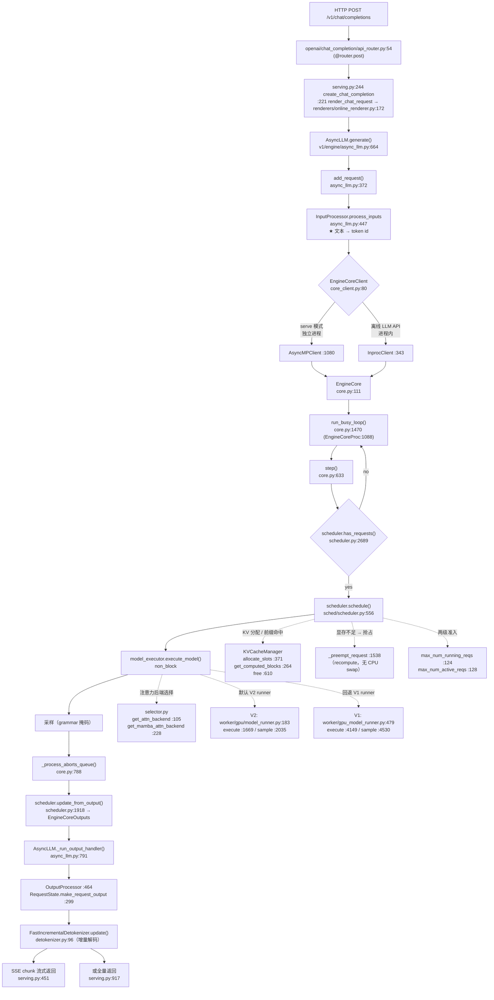

# 01C 生命周期参考图

> 与 01B 配套：先按 docs/01 自己画，再比对这张。
> 锚点为文件路径 + 行号（`00b7847c80` 实测）。行号会漂，搜符号为准。
> Mermaid 可直接渲染；文本版用于快速对照。

## Mermaid 版本



## 文本版本（快速对照）

```
HTTP POST
 └→ api_router.py:54（OpenAI 路由）→ serving.py:244 → :369 generate()
    └→ AsyncLLM.generate（async_llm.py:664）→ add_request（:372）
       └→ InputProcessor.process_inputs（:447）★ 文本 → token id
          └→ EngineCoreClient：AsyncMPClient（:1080，独立进程）/ InprocClient（:343，离线）
             └→ EngineCore（core.py:111）→ run_busy_loop（:1470）
                └→ step()（:633）：
                   ① scheduler.has_requests()？无 → 返回
                   ② scheduler.schedule()（scheduler.py:556）
                        ├→ KVCacheManager：allocate_slots（kv_cache_manager.py:371）
                        │                 get_computed_blocks（:264，前缀复用）
                        │                 free（:610）
                        └→ 不足时 _preempt_request（:1538）→ recompute，回 waiting 队首
                   ③ model_executor.execute_model(non_block)
                        └→ attention 后端由 selector 决定（selector.py:105/228）
                        └→ 默认 V2 runner（worker/gpu/model_runner.py:1669）
                   ④ 采样（grammar mask）
                   ⑤ _process_aborts_queue()（core.py:788）
                   ⑥ scheduler.update_from_output()（scheduler.py:1918）→ EngineCoreOutputs
          └→ _run_output_handler（async_llm.py:791）
             └→ OutputProcessor：make_request_output（output_processor.py:299）
                └→ FastIncrementalDetokenizer.update（detokenizer.py:96）增量解码
                   └→ get_next_output_text → SSE chunks（serving.py:451）
```

## 三句话总结

1. 一个 step = 调度 → 执行 → 更新输出（`core.py:633`）。
2. serve 与离线只差通信层（AsyncMPClient vs InprocClient），引擎本体同一套。
3. 流式 = 增量 detokenizer，每 step 只解新增 token。

## V0 差异（只有这些）

- 抢占：V0 有 swap（KV 挪 CPU），V1 只有 recompute。
- 引擎类：V0 的 `LLMEngine` / `AsyncLLMEngine` 现在只是 `v1` 的 7 行别名。
- detokenize：V0 整句回解，V1 增量。

## ⚠️ 第 5 层有两条路

`model_executor.execute_model()` 之后不是单一实现：

|        | V2（默认）                                                                      | V1（回退）                            |
| ------ | ------------------------------------------------------------------------------- | ------------------------------------- |
| 路径   | `v1/worker/gpu/model_runner.py:183`                                           | `v1/worker/gpu_model_runner.py:479` |
| 规模   | `gpu/` 下 87 个 .py                                                           | 7528 行                               |
| 选择点 | `gpu_worker.py:474`（打印 `Using V2 Model Runner` `:475`）/ 分支 `:503` | 同上 else 分支                        |

**判定**：`config/vllm.py:698 use_v2_model_runner` → `_get_v2_model_runner_unsupported_features()`（`:2988`）非空则回退。回退项：`mamba_cache_mode == "all"`、`ngram`/`draft_model`/`medusa` 等投机方法、ubatching、elastic EP、stock torch.compile。

**纪律**：先 grep 启动日志的 `Using V2 Model Runner`，再决定读哪份源码。